**Purpose:** Phosphosite-level SILAC ratio normalization, differential
phosphorylation by genotype and nutrient, and serine/threonine motif enrichment
(rmotifx).

**Inputs:** `data/Phospho (STY)Sites.csv`, `tables/normed_ratio_perseus.csv`

**Outputs:** `tables/normed_pSite_ratio_perseus.csv`,
`tables/DE_pSites_byGenotype.csv`, `tables/DE_pSites_bynutrient.csv`,
motif tables in `tables/motif_sig*.csv`, figures in `plots/`.


#load packages


#read in pSite table


#look at the pSite normalized ratios

```
## Using Proteins, id, pSite, Leading proteins, Protein names, Gene names, Fasta headers, Sequence window as id variables
## Warning: Removed 207539 rows containing non-finite outside the scale range (`stat_boxplot()`).
```

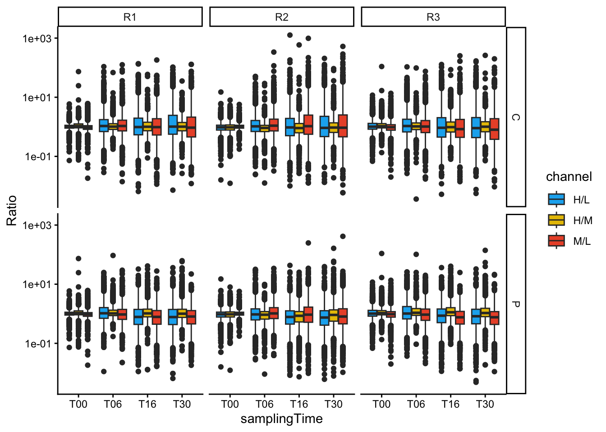

```
## `summarise()` has regrouped the output.
## ℹ Summaries were computed grouped by channel, nutrient, samplingTime, and replicate.
## ℹ Output is grouped by channel, nutrient, and samplingTime.
## ℹ Use `summarise(.groups = "drop_last")` to silence this message.
## ℹ Use `summarise(.by = c(channel, nutrient, samplingTime, replicate))` for per-operation grouping (`?dplyr::dplyr_by`) instead.
## `summarise()` has regrouped the output.
## ℹ Summaries were computed grouped by channel, nutrient, samplingTime, and replicate.
## ℹ Output is grouped by channel, nutrient, and samplingTime.
## ℹ Use `summarise(.groups = "drop_last")` to silence this message.
## ℹ Use `summarise(.by = c(channel, nutrient, samplingTime, replicate))` for per-operation grouping (`?dplyr::dplyr_by`) instead.
## Warning in geom_line(aes(x = samplingTime, y = entries, col = replicate, : Ignoring unknown aesthetics: fill
```

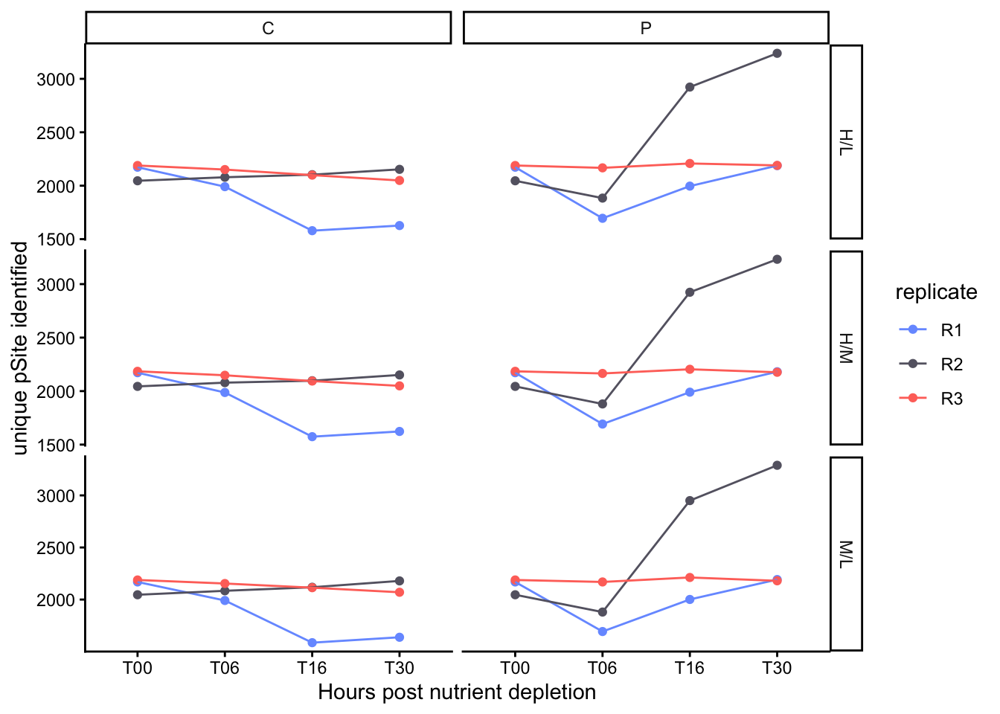

```
## Warning: The dot-dot notation (`..density..`) was deprecated in ggplot2 3.4.0.
## ℹ Please use `after_stat(density)` instead.
## This warning is displayed once per session.
## Call `lifecycle::last_lifecycle_warnings()` to see where this warning was generated.
## `stat_bin()` using `bins = 30`. Pick better value `binwidth`.
## Warning: Removed 207539 rows containing non-finite outside the scale range (`stat_bin()`).
## Warning: Removed 207539 rows containing non-finite outside the scale range (`stat_density()`).
```

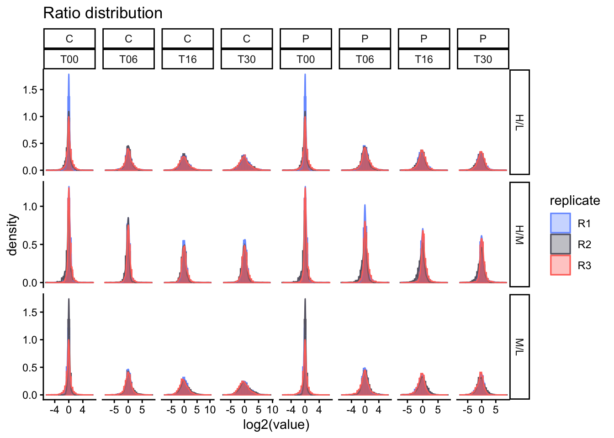

```
## Warning: Removed 83822 rows containing non-finite outside the scale range (`stat_cor()`).
## Warning: Removed 83822 rows containing missing values or values outside the scale range (`geom_point()`).
```

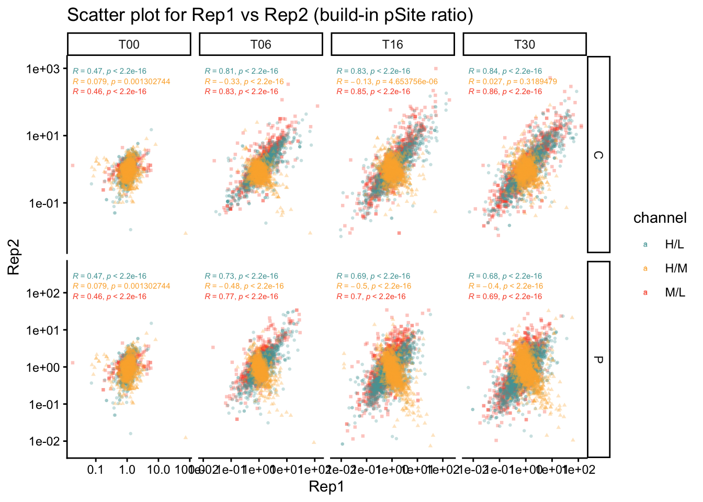

```
## Warning: Removed 84826 rows containing non-finite outside the scale range (`stat_cor()`).
## Warning: Removed 84826 rows containing missing values or values outside the scale range (`geom_point()`).
```

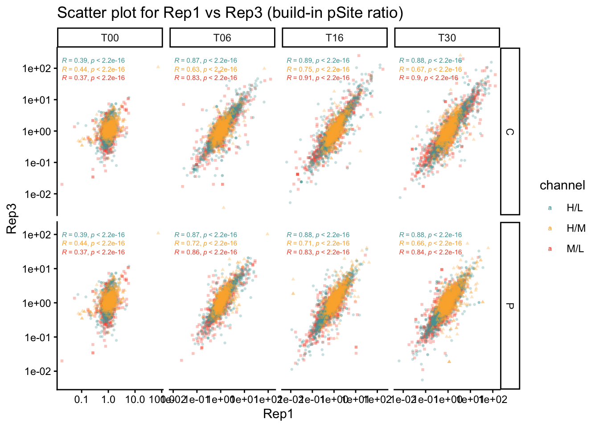

```
## Joining with `by = join_by(Proteins, id, pSite, `Leading proteins`, `Protein names`, `Gene names`, `Fasta headers`, `Sequence
## window`, channel, nutrient, samplingTime, replicate, value)`
```

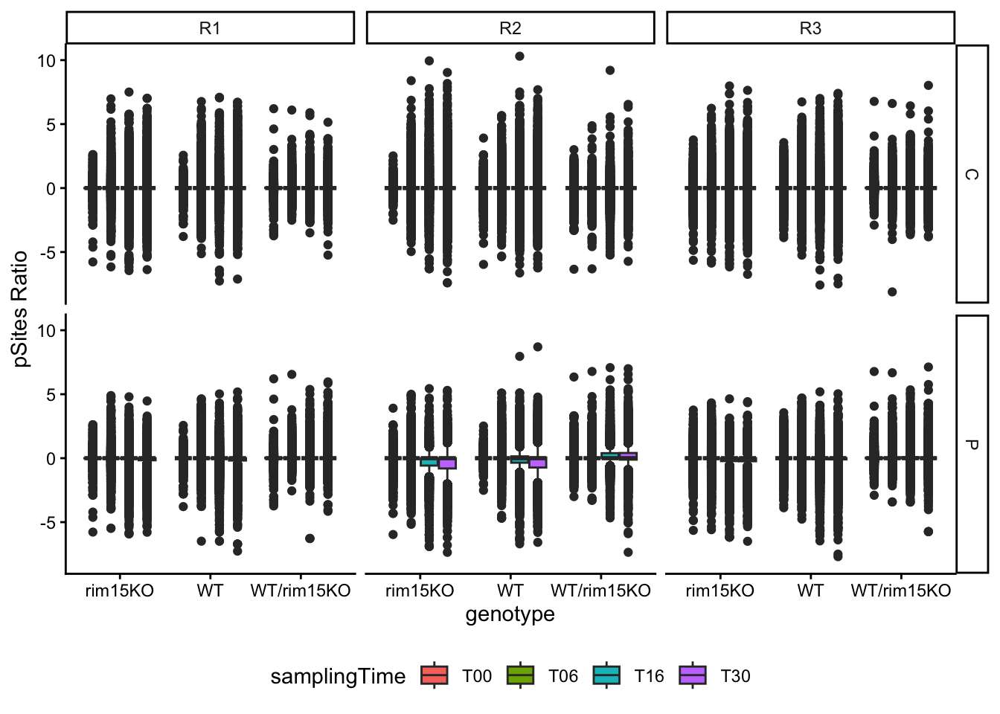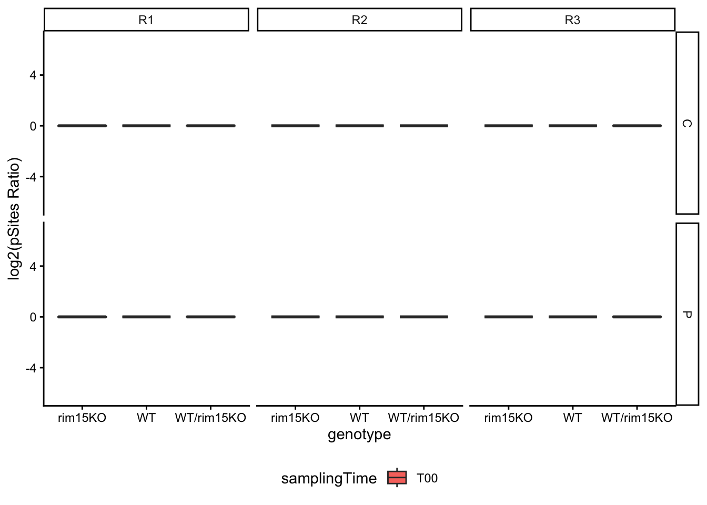

```
## `stat_bin()` using `bins = 30`. Pick better value `binwidth`.
```

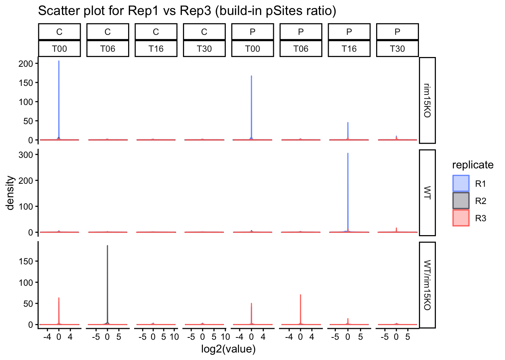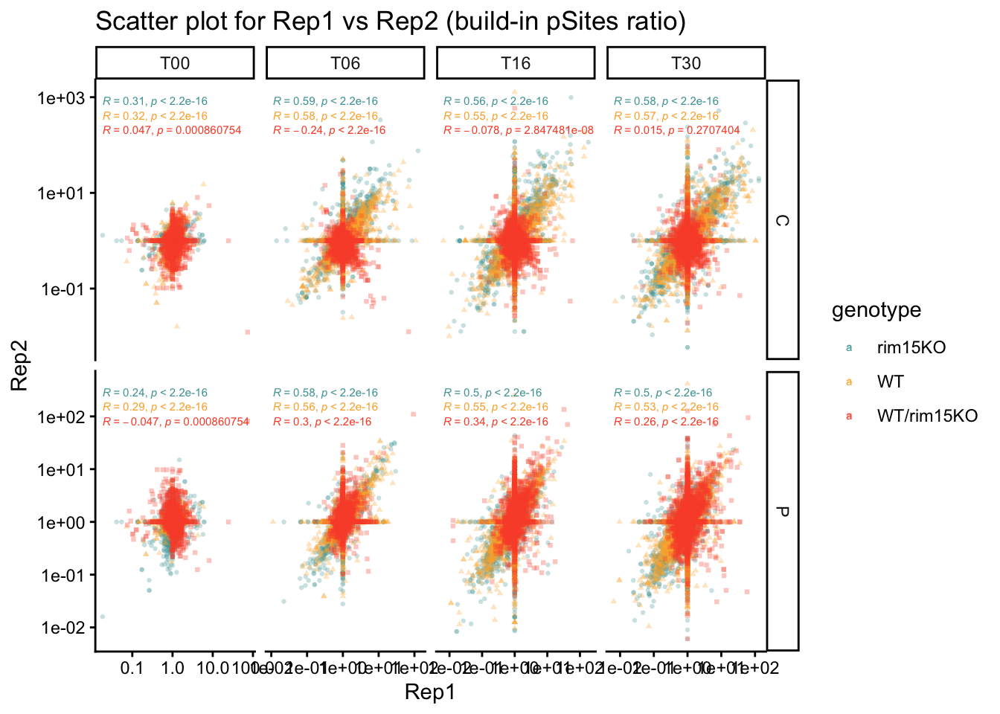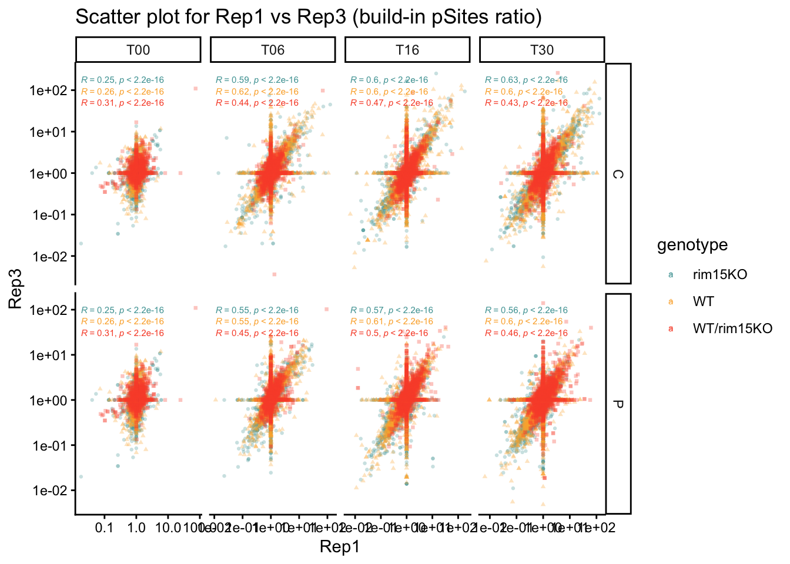

```
## Warning: `as.tibble()` was deprecated in tibble 2.0.0.
## ℹ Please use `as_tibble()` instead.
## ℹ The signature and semantics have changed, see `?as_tibble`.
## This warning is displayed once per session.
## Call `lifecycle::last_lifecycle_warnings()` to see where this warning was generated.
```

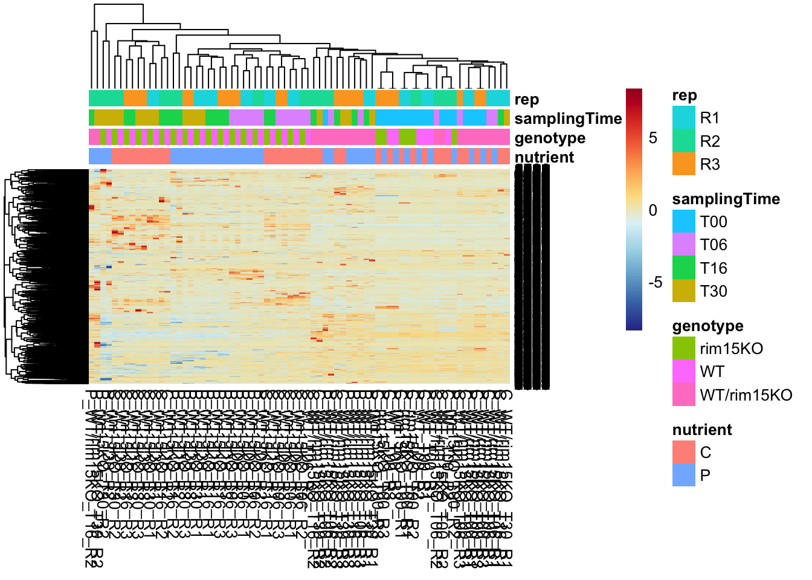

```
## pdf 
##   3
## pdf 
##   3
## [1]   48 5021
## pdf 
##   3
## No scatter3d mode specifed:
##   Setting the mode to markers
##   Read more about this attribute -> https://plotly.com/r/reference/#scatter-mode
## Warning in RColorBrewer::brewer.pal(max(N, 3L), "Set2"): n too large, allowed maximum for palette Set2 is 8
## Returning the palette you asked for with that many colors
## Warning in RColorBrewer::brewer.pal(max(N, 3L), "Set2"): n too large, allowed maximum for palette Set2 is 8
## Returning the palette you asked for with that many colors
## Warning: 'scatter3d' objects don't have these attributes: 'xlab', 'ylab', 'zlab'
## Valid attributes include:
## 'connectgaps', 'customdata', 'customdatasrc', 'error_x', 'error_y', 'error_z', 'hoverinfo', 'hoverinfosrc', 'hoverlabel', 'hovertemplate', 'hovertemplatesrc', 'hovertext', 'hovertextsrc', 'ids', 'idssrc', 'legend', 'legendgroup', 'legendgrouptitle', 'legendrank', 'legendwidth', 'line', 'marker', 'meta', 'metasrc', 'mode', 'name', 'opacity', 'projection', 'scene', 'showlegend', 'stream', 'surfaceaxis', 'surfacecolor', 'text', 'textfont', 'textposition', 'textpositionsrc', 'textsrc', 'texttemplate', 'texttemplatesrc', 'transforms', 'type', 'uid', 'uirevision', 'visible', 'x', 'xcalendar', 'xhoverformat', 'xsrc', 'y', 'ycalendar', 'yhoverformat', 'ysrc', 'z', 'zcalendar', 'zhoverformat', 'zsrc', 'key', 'set', 'frame', 'transforms', '_isNestedKey', '_isSimpleKey', '_isGraticule', '_bbox'
## Warning: 'scatter3d' objects don't have these attributes: 'xlab', 'ylab', 'zlab'
## Valid attributes include:
## 'connectgaps', 'customdata', 'customdatasrc', 'error_x', 'error_y', 'error_z', 'hoverinfo', 'hoverinfosrc', 'hoverlabel', 'hovertemplate', 'hovertemplatesrc', 'hovertext', 'hovertextsrc', 'ids', 'idssrc', 'legend', 'legendgroup', 'legendgrouptitle', 'legendrank', 'legendwidth', 'line', 'marker', 'meta', 'metasrc', 'mode', 'name', 'opacity', 'projection', 'scene', 'showlegend', 'stream', 'surfaceaxis', 'surfacecolor', 'text', 'textfont', 'textposition', 'textpositionsrc', 'textsrc', 'texttemplate', 'texttemplatesrc', 'transforms', 'type', 'uid', 'uirevision', 'visible', 'x', 'xcalendar', 'xhoverformat', 'xsrc', 'y', 'ycalendar', 'yhoverformat', 'ysrc', 'z', 'zcalendar', 'zhoverformat', 'zsrc', 'key', 'set', 'frame', 'transforms', '_isNestedKey', '_isSimpleKey', '_isGraticule', '_bbox'
## Warning: 'scatter3d' objects don't have these attributes: 'xlab', 'ylab', 'zlab'
## Valid attributes include:
## 'connectgaps', 'customdata', 'customdatasrc', 'error_x', 'error_y', 'error_z', 'hoverinfo', 'hoverinfosrc', 'hoverlabel', 'hovertemplate', 'hovertemplatesrc', 'hovertext', 'hovertextsrc', 'ids', 'idssrc', 'legend', 'legendgroup', 'legendgrouptitle', 'legendrank', 'legendwidth', 'line', 'marker', 'meta', 'metasrc', 'mode', 'name', 'opacity', 'projection', 'scene', 'showlegend', 'stream', 'surfaceaxis', 'surfacecolor', 'text', 'textfont', 'textposition', 'textpositionsrc', 'textsrc', 'texttemplate', 'texttemplatesrc', 'transforms', 'type', 'uid', 'uirevision', 'visible', 'x', 'xcalendar', 'xhoverformat', 'xsrc', 'y', 'ycalendar', 'yhoverformat', 'ysrc', 'z', 'zcalendar', 'zhoverformat', 'zsrc', 'key', 'set', 'frame', 'transforms', '_isNestedKey', '_isSimpleKey', '_isGraticule', '_bbox'
## Warning: 'scatter3d' objects don't have these attributes: 'xlab', 'ylab', 'zlab'
## Valid attributes include:
## 'connectgaps', 'customdata', 'customdatasrc', 'error_x', 'error_y', 'error_z', 'hoverinfo', 'hoverinfosrc', 'hoverlabel', 'hovertemplate', 'hovertemplatesrc', 'hovertext', 'hovertextsrc', 'ids', 'idssrc', 'legend', 'legendgroup', 'legendgrouptitle', 'legendrank', 'legendwidth', 'line', 'marker', 'meta', 'metasrc', 'mode', 'name', 'opacity', 'projection', 'scene', 'showlegend', 'stream', 'surfaceaxis', 'surfacecolor', 'text', 'textfont', 'textposition', 'textpositionsrc', 'textsrc', 'texttemplate', 'texttemplatesrc', 'transforms', 'type', 'uid', 'uirevision', 'visible', 'x', 'xcalendar', 'xhoverformat', 'xsrc', 'y', 'ycalendar', 'yhoverformat', 'ysrc', 'z', 'zcalendar', 'zhoverformat', 'zsrc', 'key', 'set', 'frame', 'transforms', '_isNestedKey', '_isSimpleKey', '_isGraticule', '_bbox'
## Warning: 'scatter3d' objects don't have these attributes: 'xlab', 'ylab', 'zlab'
## Valid attributes include:
## 'connectgaps', 'customdata', 'customdatasrc', 'error_x', 'error_y', 'error_z', 'hoverinfo', 'hoverinfosrc', 'hoverlabel', 'hovertemplate', 'hovertemplatesrc', 'hovertext', 'hovertextsrc', 'ids', 'idssrc', 'legend', 'legendgroup', 'legendgrouptitle', 'legendrank', 'legendwidth', 'line', 'marker', 'meta', 'metasrc', 'mode', 'name', 'opacity', 'projection', 'scene', 'showlegend', 'stream', 'surfaceaxis', 'surfacecolor', 'text', 'textfont', 'textposition', 'textpositionsrc', 'textsrc', 'texttemplate', 'texttemplatesrc', 'transforms', 'type', 'uid', 'uirevision', 'visible', 'x', 'xcalendar', 'xhoverformat', 'xsrc', 'y', 'ycalendar', 'yhoverformat', 'ysrc', 'z', 'zcalendar', 'zhoverformat', 'zsrc', 'key', 'set', 'frame', 'transforms', '_isNestedKey', '_isSimpleKey', '_isGraticule', '_bbox'
## Warning: 'scatter3d' objects don't have these attributes: 'xlab', 'ylab', 'zlab'
## Valid attributes include:
## 'connectgaps', 'customdata', 'customdatasrc', 'error_x', 'error_y', 'error_z', 'hoverinfo', 'hoverinfosrc', 'hoverlabel', 'hovertemplate', 'hovertemplatesrc', 'hovertext', 'hovertextsrc', 'ids', 'idssrc', 'legend', 'legendgroup', 'legendgrouptitle', 'legendrank', 'legendwidth', 'line', 'marker', 'meta', 'metasrc', 'mode', 'name', 'opacity', 'projection', 'scene', 'showlegend', 'stream', 'surfaceaxis', 'surfacecolor', 'text', 'textfont', 'textposition', 'textpositionsrc', 'textsrc', 'texttemplate', 'texttemplatesrc', 'transforms', 'type', 'uid', 'uirevision', 'visible', 'x', 'xcalendar', 'xhoverformat', 'xsrc', 'y', 'ycalendar', 'yhoverformat', 'ysrc', 'z', 'zcalendar', 'zhoverformat', 'zsrc', 'key', 'set', 'frame', 'transforms', '_isNestedKey', '_isSimpleKey', '_isGraticule', '_bbox'
## Warning: 'scatter3d' objects don't have these attributes: 'xlab', 'ylab', 'zlab'
## Valid attributes include:
## 'connectgaps', 'customdata', 'customdatasrc', 'error_x', 'error_y', 'error_z', 'hoverinfo', 'hoverinfosrc', 'hoverlabel', 'hovertemplate', 'hovertemplatesrc', 'hovertext', 'hovertextsrc', 'ids', 'idssrc', 'legend', 'legendgroup', 'legendgrouptitle', 'legendrank', 'legendwidth', 'line', 'marker', 'meta', 'metasrc', 'mode', 'name', 'opacity', 'projection', 'scene', 'showlegend', 'stream', 'surfaceaxis', 'surfacecolor', 'text', 'textfont', 'textposition', 'textpositionsrc', 'textsrc', 'texttemplate', 'texttemplatesrc', 'transforms', 'type', 'uid', 'uirevision', 'visible', 'x', 'xcalendar', 'xhoverformat', 'xsrc', 'y', 'ycalendar', 'yhoverformat', 'ysrc', 'z', 'zcalendar', 'zhoverformat', 'zsrc', 'key', 'set', 'frame', 'transforms', '_isNestedKey', '_isSimpleKey', '_isGraticule', '_bbox'
## Warning: 'scatter3d' objects don't have these attributes: 'xlab', 'ylab', 'zlab'
## Valid attributes include:
## 'connectgaps', 'customdata', 'customdatasrc', 'error_x', 'error_y', 'error_z', 'hoverinfo', 'hoverinfosrc', 'hoverlabel', 'hovertemplate', 'hovertemplatesrc', 'hovertext', 'hovertextsrc', 'ids', 'idssrc', 'legend', 'legendgroup', 'legendgrouptitle', 'legendrank', 'legendwidth', 'line', 'marker', 'meta', 'metasrc', 'mode', 'name', 'opacity', 'projection', 'scene', 'showlegend', 'stream', 'surfaceaxis', 'surfacecolor', 'text', 'textfont', 'textposition', 'textpositionsrc', 'textsrc', 'texttemplate', 'texttemplatesrc', 'transforms', 'type', 'uid', 'uirevision', 'visible', 'x', 'xcalendar', 'xhoverformat', 'xsrc', 'y', 'ycalendar', 'yhoverformat', 'ysrc', 'z', 'zcalendar', 'zhoverformat', 'zsrc', 'key', 'set', 'frame', 'transforms', '_isNestedKey', '_isSimpleKey', '_isGraticule', '_bbox'
## Warning: 'scatter3d' objects don't have these attributes: 'xlab', 'ylab', 'zlab'
## Valid attributes include:
## 'connectgaps', 'customdata', 'customdatasrc', 'error_x', 'error_y', 'error_z', 'hoverinfo', 'hoverinfosrc', 'hoverlabel', 'hovertemplate', 'hovertemplatesrc', 'hovertext', 'hovertextsrc', 'ids', 'idssrc', 'legend', 'legendgroup', 'legendgrouptitle', 'legendrank', 'legendwidth', 'line', 'marker', 'meta', 'metasrc', 'mode', 'name', 'opacity', 'projection', 'scene', 'showlegend', 'stream', 'surfaceaxis', 'surfacecolor', 'text', 'textfont', 'textposition', 'textpositionsrc', 'textsrc', 'texttemplate', 'texttemplatesrc', 'transforms', 'type', 'uid', 'uirevision', 'visible', 'x', 'xcalendar', 'xhoverformat', 'xsrc', 'y', 'ycalendar', 'yhoverformat', 'ysrc', 'z', 'zcalendar', 'zhoverformat', 'zsrc', 'key', 'set', 'frame', 'transforms', '_isNestedKey', '_isSimpleKey', '_isGraticule', '_bbox'
## Warning: 'scatter3d' objects don't have these attributes: 'xlab', 'ylab', 'zlab'
## Valid attributes include:
## 'connectgaps', 'customdata', 'customdatasrc', 'error_x', 'error_y', 'error_z', 'hoverinfo', 'hoverinfosrc', 'hoverlabel', 'hovertemplate', 'hovertemplatesrc', 'hovertext', 'hovertextsrc', 'ids', 'idssrc', 'legend', 'legendgroup', 'legendgrouptitle', 'legendrank', 'legendwidth', 'line', 'marker', 'meta', 'metasrc', 'mode', 'name', 'opacity', 'projection', 'scene', 'showlegend', 'stream', 'surfaceaxis', 'surfacecolor', 'text', 'textfont', 'textposition', 'textpositionsrc', 'textsrc', 'texttemplate', 'texttemplatesrc', 'transforms', 'type', 'uid', 'uirevision', 'visible', 'x', 'xcalendar', 'xhoverformat', 'xsrc', 'y', 'ycalendar', 'yhoverformat', 'ysrc', 'z', 'zcalendar', 'zhoverformat', 'zsrc', 'key', 'set', 'frame', 'transforms', '_isNestedKey', '_isSimpleKey', '_isGraticule', '_bbox'
## Warning: 'scatter3d' objects don't have these attributes: 'xlab', 'ylab', 'zlab'
## Valid attributes include:
## 'connectgaps', 'customdata', 'customdatasrc', 'error_x', 'error_y', 'error_z', 'hoverinfo', 'hoverinfosrc', 'hoverlabel', 'hovertemplate', 'hovertemplatesrc', 'hovertext', 'hovertextsrc', 'ids', 'idssrc', 'legend', 'legendgroup', 'legendgrouptitle', 'legendrank', 'legendwidth', 'line', 'marker', 'meta', 'metasrc', 'mode', 'name', 'opacity', 'projection', 'scene', 'showlegend', 'stream', 'surfaceaxis', 'surfacecolor', 'text', 'textfont', 'textposition', 'textpositionsrc', 'textsrc', 'texttemplate', 'texttemplatesrc', 'transforms', 'type', 'uid', 'uirevision', 'visible', 'x', 'xcalendar', 'xhoverformat', 'xsrc', 'y', 'ycalendar', 'yhoverformat', 'ysrc', 'z', 'zcalendar', 'zhoverformat', 'zsrc', 'key', 'set', 'frame', 'transforms', '_isNestedKey', '_isSimpleKey', '_isGraticule', '_bbox'
## Warning: 'scatter3d' objects don't have these attributes: 'xlab', 'ylab', 'zlab'
## Valid attributes include:
## 'connectgaps', 'customdata', 'customdatasrc', 'error_x', 'error_y', 'error_z', 'hoverinfo', 'hoverinfosrc', 'hoverlabel', 'hovertemplate', 'hovertemplatesrc', 'hovertext', 'hovertextsrc', 'ids', 'idssrc', 'legend', 'legendgroup', 'legendgrouptitle', 'legendrank', 'legendwidth', 'line', 'marker', 'meta', 'metasrc', 'mode', 'name', 'opacity', 'projection', 'scene', 'showlegend', 'stream', 'surfaceaxis', 'surfacecolor', 'text', 'textfont', 'textposition', 'textpositionsrc', 'textsrc', 'texttemplate', 'texttemplatesrc', 'transforms', 'type', 'uid', 'uirevision', 'visible', 'x', 'xcalendar', 'xhoverformat', 'xsrc', 'y', 'ycalendar', 'yhoverformat', 'ysrc', 'z', 'zcalendar', 'zhoverformat', 'zsrc', 'key', 'set', 'frame', 'transforms', '_isNestedKey', '_isSimpleKey', '_isGraticule', '_bbox'
## Warning: 'scatter3d' objects don't have these attributes: 'xlab', 'ylab', 'zlab'
## Valid attributes include:
## 'connectgaps', 'customdata', 'customdatasrc', 'error_x', 'error_y', 'error_z', 'hoverinfo', 'hoverinfosrc', 'hoverlabel', 'hovertemplate', 'hovertemplatesrc', 'hovertext', 'hovertextsrc', 'ids', 'idssrc', 'legend', 'legendgroup', 'legendgrouptitle', 'legendrank', 'legendwidth', 'line', 'marker', 'meta', 'metasrc', 'mode', 'name', 'opacity', 'projection', 'scene', 'showlegend', 'stream', 'surfaceaxis', 'surfacecolor', 'text', 'textfont', 'textposition', 'textpositionsrc', 'textsrc', 'texttemplate', 'texttemplatesrc', 'transforms', 'type', 'uid', 'uirevision', 'visible', 'x', 'xcalendar', 'xhoverformat', 'xsrc', 'y', 'ycalendar', 'yhoverformat', 'ysrc', 'z', 'zcalendar', 'zhoverformat', 'zsrc', 'key', 'set', 'frame', 'transforms', '_isNestedKey', '_isSimpleKey', '_isGraticule', '_bbox'
## Warning: 'scatter3d' objects don't have these attributes: 'xlab', 'ylab', 'zlab'
## Valid attributes include:
## 'connectgaps', 'customdata', 'customdatasrc', 'error_x', 'error_y', 'error_z', 'hoverinfo', 'hoverinfosrc', 'hoverlabel', 'hovertemplate', 'hovertemplatesrc', 'hovertext', 'hovertextsrc', 'ids', 'idssrc', 'legend', 'legendgroup', 'legendgrouptitle', 'legendrank', 'legendwidth', 'line', 'marker', 'meta', 'metasrc', 'mode', 'name', 'opacity', 'projection', 'scene', 'showlegend', 'stream', 'surfaceaxis', 'surfacecolor', 'text', 'textfont', 'textposition', 'textpositionsrc', 'textsrc', 'texttemplate', 'texttemplatesrc', 'transforms', 'type', 'uid', 'uirevision', 'visible', 'x', 'xcalendar', 'xhoverformat', 'xsrc', 'y', 'ycalendar', 'yhoverformat', 'ysrc', 'z', 'zcalendar', 'zhoverformat', 'zsrc', 'key', 'set', 'frame', 'transforms', '_isNestedKey', '_isSimpleKey', '_isGraticule', '_bbox'
## Warning: 'scatter3d' objects don't have these attributes: 'xlab', 'ylab', 'zlab'
## Valid attributes include:
## 'connectgaps', 'customdata', 'customdatasrc', 'error_x', 'error_y', 'error_z', 'hoverinfo', 'hoverinfosrc', 'hoverlabel', 'hovertemplate', 'hovertemplatesrc', 'hovertext', 'hovertextsrc', 'ids', 'idssrc', 'legend', 'legendgroup', 'legendgrouptitle', 'legendrank', 'legendwidth', 'line', 'marker', 'meta', 'metasrc', 'mode', 'name', 'opacity', 'projection', 'scene', 'showlegend', 'stream', 'surfaceaxis', 'surfacecolor', 'text', 'textfont', 'textposition', 'textpositionsrc', 'textsrc', 'texttemplate', 'texttemplatesrc', 'transforms', 'type', 'uid', 'uirevision', 'visible', 'x', 'xcalendar', 'xhoverformat', 'xsrc', 'y', 'ycalendar', 'yhoverformat', 'ysrc', 'z', 'zcalendar', 'zhoverformat', 'zsrc', 'key', 'set', 'frame', 'transforms', '_isNestedKey', '_isSimpleKey', '_isGraticule', '_bbox'
## Warning: 'scatter3d' objects don't have these attributes: 'xlab', 'ylab', 'zlab'
## Valid attributes include:
## 'connectgaps', 'customdata', 'customdatasrc', 'error_x', 'error_y', 'error_z', 'hoverinfo', 'hoverinfosrc', 'hoverlabel', 'hovertemplate', 'hovertemplatesrc', 'hovertext', 'hovertextsrc', 'ids', 'idssrc', 'legend', 'legendgroup', 'legendgrouptitle', 'legendrank', 'legendwidth', 'line', 'marker', 'meta', 'metasrc', 'mode', 'name', 'opacity', 'projection', 'scene', 'showlegend', 'stream', 'surfaceaxis', 'surfacecolor', 'text', 'textfont', 'textposition', 'textpositionsrc', 'textsrc', 'texttemplate', 'texttemplatesrc', 'transforms', 'type', 'uid', 'uirevision', 'visible', 'x', 'xcalendar', 'xhoverformat', 'xsrc', 'y', 'ycalendar', 'yhoverformat', 'ysrc', 'z', 'zcalendar', 'zhoverformat', 'zsrc', 'key', 'set', 'frame', 'transforms', '_isNestedKey', '_isSimpleKey', '_isGraticule', '_bbox'
```


```{=html}
<div class="plotly html-widget html-fill-item" id="htmlwidget-66d559454ecd730d7db7" style="width:672px;height:480px;"></div>
<script type="application/json" data-for="htmlwidget-66d559454ecd730d7db7">{"x":{"visdat":{"2d2923ca2cdc":["function () ","plotlyVisDat"]},"cur_data":"2d2923ca2cdc","attrs":{"2d2923ca2cdc":{"x":[-26.756511464618647,-25.601185004302739,-26.912594750575774,-13.229137973911907,-10.232046103440783,-9.3049716158485634,-7.098680469248305,6.6251217819341601,7.8199675683408154,-2.7343291221811961,11.935252484778792,10.096174420665633,-26.13819544662682,-22.872146120752262,-30.914896529432216,-9.0284836956282426,-10.018311237010458,-4.179858695595132,-2.7183164715361761,3.3271309369675337,14.709888527232685,-1.1049581925693268,4.8449455692146612,14.625098563354229,-26.756511464618647,-22.872146120752262,-26.912594750575774,-10.456981470912154,-7.854542487882834,-1.3434655263661355,9.4471664452700477,31.82078277442082,12.624134495965432,14.722974062192648,68.198192573954032,13.608238958028604,-26.13819544662682,-25.601185004302739,-30.914896529432216,-9.6835749792163117,-8.709593538465418,-0.20503875446658454,13.260254617454988,43.612319330472808,18.51753433901111,20.791547961958241,86.923531477070185,18.783092078608281],"y":[16.817261186327446,14.687200658864937,16.054221713723134,-7.8136631938137491,-12.836834356675054,-7.617191845859665,-20.479366785466613,-44.475334515240235,-33.514716698360651,-34.482444591782432,-56.382731099053906,-39.350079691493384,15.229679797404367,16.07787688586016,13.087708924569649,-8.3084614466620383,-3.8268538300945116,-15.14144882214331,-22.470738308529956,-26.152500854908492,-35.112157055527888,-29.412657696633936,-41.507099289735123,-38.506630821527509,16.817261186327446,16.07787688586016,16.054221713723134,15.742497233835426,20.732792524658791,19.775156599268474,16.020338412505854,25.671505360255072,16.980294597135394,14.230679739057706,38.059015988285836,16.972757197847837,15.229679797404367,14.687200658864937,13.087708924569649,11.332120149536786,11.965105188783983,10.865592235142401,9.8069274796897723,10.640399529389477,8.8691282162563425,10.868272176084686,25.637789530333386,9.3126404119412651],"z":[-13.006433503374295,-11.048337092794783,-13.441025962488924,-2.6573145373467812,-2.4285225606870839,-2.0519963405762054,-1.9812906416487261,-1.3797052975942234,-5.3512474293573682,-5.7721623908134507,2.6250045725283573,-6.9979179971577494,-11.963836109145284,-8.9925039545094752,-17.037580590856038,-0.92113186509752398,-0.69170368597723209,-2.279601963842286,1.1423213020119107,0.7540355284117467,-2.8692502194557226,-2.4333287771030316,0.75225396013461898,-3.0377827817387155,-13.006433503374295,-8.9925039545094752,-13.441025962488924,9.4007862358428707,16.232604868090814,17.882998851720572,19.648880992908914,34.456442970215754,20.905895398716869,18.281637037867615,-32.163716575107131,15.694734316481377,-11.963836109145284,-11.048337092794783,-17.037580590856038,10.128516922847991,10.125052315119122,16.510444085715385,19.582001319547579,25.618600301400786,18.820192944142338,19.490307700528568,-66.75870336344002,12.702099229048008],"xlab":"PC1","ylab":"PC2","zlab":"PC3","color":["C_rim15KO_T00","C_rim15KO_T00","C_rim15KO_T00","C_rim15KO_T06","C_rim15KO_T06","C_rim15KO_T06","C_rim15KO_T16","C_rim15KO_T16","C_rim15KO_T16","C_rim15KO_T30","C_rim15KO_T30","C_rim15KO_T30","C_WT_T00","C_WT_T00","C_WT_T00","C_WT_T06","C_WT_T06","C_WT_T06","C_WT_T16","C_WT_T16","C_WT_T16","C_WT_T30","C_WT_T30","C_WT_T30","P_rim15KO_T00","P_rim15KO_T00","P_rim15KO_T00","P_rim15KO_T06","P_rim15KO_T06","P_rim15KO_T06","P_rim15KO_T16","P_rim15KO_T16","P_rim15KO_T16","P_rim15KO_T30","P_rim15KO_T30","P_rim15KO_T30","P_WT_T00","P_WT_T00","P_WT_T00","P_WT_T06","P_WT_T06","P_WT_T06","P_WT_T16","P_WT_T16","P_WT_T16","P_WT_T30","P_WT_T30","P_WT_T30"],"alpha_stroke":1,"sizes":[10,100],"spans":[1,20],"type":"scatter3d"}},"layout":{"margin":{"b":40,"l":60,"t":25,"r":10},"scene":{"xaxis":{"title":[]},"yaxis":{"title":[]},"zaxis":{"title":[]}},"hovermode":"closest","showlegend":true},"source":"A","config":{"modeBarButtonsToAdd":["hoverclosest","hovercompare"],"showSendToCloud":false},"data":[{"x":[-26.13819544662682,-22.872146120752262,-30.914896529432216],"y":[15.229679797404367,16.07787688586016,13.087708924569649],"z":[-11.963836109145284,-8.9925039545094752,-17.037580590856038],"xlab":"PC1","ylab":"PC2","zlab":"PC3","type":"scatter3d","mode":"markers","name":"C_WT_T00","marker":{"color":"rgba(162,158,189,1)","line":{"color":"rgba(162,158,189,1)"}},"textfont":{"color":"rgba(162,158,189,1)"},"error_y":{"color":"rgba(162,158,189,1)"},"error_x":{"color":"rgba(162,158,189,1)"},"line":{"color":"rgba(162,158,189,1)"},"frame":null},{"x":[-9.0284836956282426,-10.018311237010458,-4.179858695595132],"y":[-8.3084614466620383,-3.8268538300945116,-15.14144882214331],"z":[-0.92113186509752398,-0.69170368597723209,-2.279601963842286],"xlab":"PC1","ylab":"PC2","zlab":"PC3","type":"scatter3d","mode":"markers","name":"C_WT_T06","marker":{"color":"rgba(175,154,200,1)","line":{"color":"rgba(175,154,200,1)"}},"textfont":{"color":"rgba(175,154,200,1)"},"error_y":{"color":"rgba(175,154,200,1)"},"error_x":{"color":"rgba(175,154,200,1)"},"line":{"color":"rgba(175,154,200,1)"},"frame":null},{"x":[-2.7183164715361761,3.3271309369675337,14.709888527232685],"y":[-22.470738308529956,-26.152500854908492,-35.112157055527888],"z":[1.1423213020119107,0.7540355284117467,-2.8692502194557226],"xlab":"PC1","ylab":"PC2","zlab":"PC3","type":"scatter3d","mode":"markers","name":"C_WT_T16","marker":{"color":"rgba(215,144,197,1)","line":{"color":"rgba(215,144,197,1)"}},"textfont":{"color":"rgba(215,144,197,1)"},"error_y":{"color":"rgba(215,144,197,1)"},"error_x":{"color":"rgba(215,144,197,1)"},"line":{"color":"rgba(215,144,197,1)"},"frame":null},{"x":[-1.1049581925693268,4.8449455692146612,14.625098563354229],"y":[-29.412657696633936,-41.507099289735123,-38.506630821527509],"z":[-2.4333287771030316,0.75225396013461898,-3.0377827817387155],"xlab":"PC1","ylab":"PC2","zlab":"PC3","type":"scatter3d","mode":"markers","name":"C_WT_T30","marker":{"color":"rgba(219,162,168,1)","line":{"color":"rgba(219,162,168,1)"}},"textfont":{"color":"rgba(219,162,168,1)"},"error_y":{"color":"rgba(219,162,168,1)"},"error_x":{"color":"rgba(219,162,168,1)"},"line":{"color":"rgba(219,162,168,1)"},"frame":null},{"x":[-26.756511464618647,-25.601185004302739,-26.912594750575774],"y":[16.817261186327446,14.687200658864937,16.054221713723134],"z":[-13.006433503374295,-11.048337092794783,-13.441025962488924],"xlab":"PC1","ylab":"PC2","zlab":"PC3","type":"scatter3d","mode":"markers","name":"C_rim15KO_T00","marker":{"color":"rgba(102,194,165,1)","line":{"color":"rgba(102,194,165,1)"}},"textfont":{"color":"rgba(102,194,165,1)"},"error_y":{"color":"rgba(102,194,165,1)"},"error_x":{"color":"rgba(102,194,165,1)"},"line":{"color":"rgba(102,194,165,1)"},"frame":null},{"x":[-13.229137973911907,-10.232046103440783,-9.3049716158485634],"y":[-7.8136631938137491,-12.836834356675054,-7.617191845859665],"z":[-2.6573145373467812,-2.4285225606870839,-2.0519963405762054],"xlab":"PC1","ylab":"PC2","zlab":"PC3","type":"scatter3d","mode":"markers","name":"C_rim15KO_T06","marker":{"color":"rgba(189,173,133,1)","line":{"color":"rgba(189,173,133,1)"}},"textfont":{"color":"rgba(189,173,133,1)"},"error_y":{"color":"rgba(189,173,133,1)"},"error_x":{"color":"rgba(189,173,133,1)"},"line":{"color":"rgba(189,173,133,1)"},"frame":null},{"x":[-7.098680469248305,6.6251217819341601,7.8199675683408154],"y":[-20.479366785466613,-44.475334515240235,-33.514716698360651],"z":[-1.9812906416487261,-1.3797052975942234,-5.3512474293573682],"xlab":"PC1","ylab":"PC2","zlab":"PC3","type":"scatter3d","mode":"markers","name":"C_rim15KO_T16","marker":{"color":"rgba(245,146,102,1)","line":{"color":"rgba(245,146,102,1)"}},"textfont":{"color":"rgba(245,146,102,1)"},"error_y":{"color":"rgba(245,146,102,1)"},"error_x":{"color":"rgba(245,146,102,1)"},"line":{"color":"rgba(245,146,102,1)"},"frame":null},{"x":[-2.7343291221811961,11.935252484778792,10.096174420665633],"y":[-34.482444591782432,-56.382731099053906,-39.350079691493384],"z":[-5.7721623908134507,2.6250045725283573,-6.9979179971577494],"xlab":"PC1","ylab":"PC2","zlab":"PC3","type":"scatter3d","mode":"markers","name":"C_rim15KO_T30","marker":{"color":"rgba(217,150,141,1)","line":{"color":"rgba(217,150,141,1)"}},"textfont":{"color":"rgba(217,150,141,1)"},"error_y":{"color":"rgba(217,150,141,1)"},"error_x":{"color":"rgba(217,150,141,1)"},"line":{"color":"rgba(217,150,141,1)"},"frame":null},{"x":[-26.13819544662682,-25.601185004302739,-30.914896529432216],"y":[15.229679797404367,14.687200658864937,13.087708924569649],"z":[-11.963836109145284,-11.048337092794783,-17.037580590856038],"xlab":"PC1","ylab":"PC2","zlab":"PC3","type":"scatter3d","mode":"markers","name":"P_WT_T00","marker":{"color":"rgba(241,204,114,1)","line":{"color":"rgba(241,204,114,1)"}},"textfont":{"color":"rgba(241,204,114,1)"},"error_y":{"color":"rgba(241,204,114,1)"},"error_x":{"color":"rgba(241,204,114,1)"},"line":{"color":"rgba(241,204,114,1)"},"frame":null},{"x":[-9.6835749792163117,-8.709593538465418,-0.20503875446658454],"y":[11.332120149536786,11.965105188783983,10.865592235142401],"z":[10.128516922847991,10.125052315119122,16.510444085715385],"xlab":"PC1","ylab":"PC2","zlab":"PC3","type":"scatter3d","mode":"markers","name":"P_WT_T06","marker":{"color":"rgba(226,195,150,1)","line":{"color":"rgba(226,195,150,1)"}},"textfont":{"color":"rgba(226,195,150,1)"},"error_y":{"color":"rgba(226,195,150,1)"},"error_x":{"color":"rgba(226,195,150,1)"},"line":{"color":"rgba(226,195,150,1)"},"frame":null},{"x":[13.260254617454988,43.612319330472808,18.51753433901111],"y":[9.8069274796897723,10.640399529389477,8.8691282162563425],"z":[19.582001319547579,25.618600301400786,18.820192944142338],"xlab":"PC1","ylab":"PC2","zlab":"PC3","type":"scatter3d","mode":"markers","name":"P_WT_T16","marker":{"color":"rgba(204,187,165,1)","line":{"color":"rgba(204,187,165,1)"}},"textfont":{"color":"rgba(204,187,165,1)"},"error_y":{"color":"rgba(204,187,165,1)"},"error_x":{"color":"rgba(204,187,165,1)"},"line":{"color":"rgba(204,187,165,1)"},"frame":null},{"x":[20.791547961958241,86.923531477070185,18.783092078608281],"y":[10.868272176084686,25.637789530333386,9.3126404119412651],"z":[19.490307700528568,-66.75870336344002,12.702099229048008],"xlab":"PC1","ylab":"PC2","zlab":"PC3","type":"scatter3d","mode":"markers","name":"P_WT_T30","marker":{"color":"rgba(179,179,179,1)","line":{"color":"rgba(179,179,179,1)"}},"textfont":{"color":"rgba(179,179,179,1)"},"error_y":{"color":"rgba(179,179,179,1)"},"error_x":{"color":"rgba(179,179,179,1)"},"line":{"color":"rgba(179,179,179,1)"},"frame":null},{"x":[-26.756511464618647,-22.872146120752262,-26.912594750575774],"y":[16.817261186327446,16.07787688586016,16.054221713723134],"z":[-13.006433503374295,-8.9925039545094752,-13.441025962488924],"xlab":"PC1","ylab":"PC2","zlab":"PC3","type":"scatter3d","mode":"markers","name":"P_rim15KO_T00","marker":{"color":"rgba(189,198,118,1)","line":{"color":"rgba(189,198,118,1)"}},"textfont":{"color":"rgba(189,198,118,1)"},"error_y":{"color":"rgba(189,198,118,1)"},"error_x":{"color":"rgba(189,198,118,1)"},"line":{"color":"rgba(189,198,118,1)"},"frame":null},{"x":[-10.456981470912154,-7.854542487882834,-1.3434655263661355],"y":[15.742497233835426,20.732792524658791,19.775156599268474],"z":[9.4007862358428707,16.232604868090814,17.882998851720572],"xlab":"PC1","ylab":"PC2","zlab":"PC3","type":"scatter3d","mode":"markers","name":"P_rim15KO_T06","marker":{"color":"rgba(186,217,78,1)","line":{"color":"rgba(186,217,78,1)"}},"textfont":{"color":"rgba(186,217,78,1)"},"error_y":{"color":"rgba(186,217,78,1)"},"error_x":{"color":"rgba(186,217,78,1)"},"line":{"color":"rgba(186,217,78,1)"},"frame":null},{"x":[9.4471664452700477,31.82078277442082,12.624134495965432],"y":[16.020338412505854,25.671505360255072,16.980294597135394],"z":[19.648880992908914,34.456442970215754,20.905895398716869],"xlab":"PC1","ylab":"PC2","zlab":"PC3","type":"scatter3d","mode":"markers","name":"P_rim15KO_T16","marker":{"color":"rgba(227,217,62,1)","line":{"color":"rgba(227,217,62,1)"}},"textfont":{"color":"rgba(227,217,62,1)"},"error_y":{"color":"rgba(227,217,62,1)"},"error_x":{"color":"rgba(227,217,62,1)"},"line":{"color":"rgba(227,217,62,1)"},"frame":null},{"x":[14.722974062192648,68.198192573954032,13.608238958028604],"y":[14.230679739057706,38.059015988285836,16.972757197847837],"z":[18.281637037867615,-32.163716575107131,15.694734316481377],"xlab":"PC1","ylab":"PC2","zlab":"PC3","type":"scatter3d","mode":"markers","name":"P_rim15KO_T30","marker":{"color":"rgba(252,214,66,1)","line":{"color":"rgba(252,214,66,1)"}},"textfont":{"color":"rgba(252,214,66,1)"},"error_y":{"color":"rgba(252,214,66,1)"},"error_x":{"color":"rgba(252,214,66,1)"},"line":{"color":"rgba(252,214,66,1)"},"frame":null}],"highlight":{"on":"plotly_click","persistent":false,"dynamic":false,"selectize":false,"opacityDim":0.20000000000000001,"selected":{"opacity":1},"debounce":0},"shinyEvents":["plotly_hover","plotly_click","plotly_selected","plotly_relayout","plotly_brushed","plotly_brushing","plotly_clickannotation","plotly_doubleclick","plotly_deselect","plotly_afterplot","plotly_sunburstclick"],"base_url":"https://plot.ly"},"evals":[],"jsHooks":[]}</script>
```


```
## Rows: 5056 Columns: 79
## ── Column specification ─────────────────────────────────────────────────────────────────────────────────────────────────────────────
## Delimiter: ","
## chr  (6): Proteins, pSite, Leading proteins, Protein names, Gene names, Fasta headers
## dbl (73): id, rim15KO_C_T00_R1, rim15KO_C_T00_R2, rim15KO_C_T00_R3, rim15KO_C_T06_R1, rim15KO_C_T06_R2, rim15KO_C_T06_R3, rim15KO...
## 
## ℹ Use `spec()` to retrieve the full column specification for this data.
## ℹ Specify the column types or set `show_col_types = FALSE` to quiet this message.
## Using Proteins, pSite, Leading proteins, Protein names, Gene names, Fasta headers as id variables
## 
## Using Proteins, pSite, Leading proteins, Protein names, Gene names, Fasta headers, cond as id variables
## Warning: Using `size` aesthetic for lines was deprecated in ggplot2 3.4.0.
## ℹ Please use `linewidth` instead.
## This warning is displayed once per session.
## Call `lifecycle::last_lifecycle_warnings()` to see where this warning was generated.
## Warning in geom_line(size = 0.3, alpha = 0.5, colours = pSite): Ignoring unknown parameters: `colours`
```

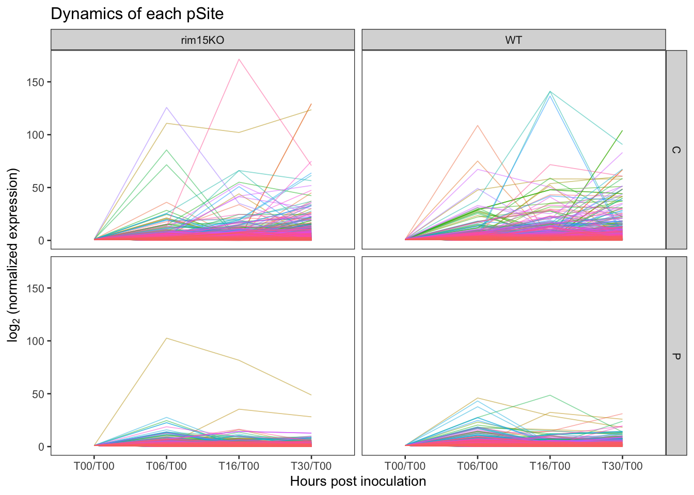

```
## Using Proteins, pSite, Leading proteins, Protein names, Gene names, Fasta headers, nutrient, time as id variables
## `summarise()` has regrouped the output.Using Proteins, pSite, Leading proteins, Protein names, Gene names, Fasta headers, nutrient, time as id variables
## `summarise()` has regrouped the output.
## Warning: Removed 16 rows containing missing values or values outside the scale range (`geom_point()`).
```

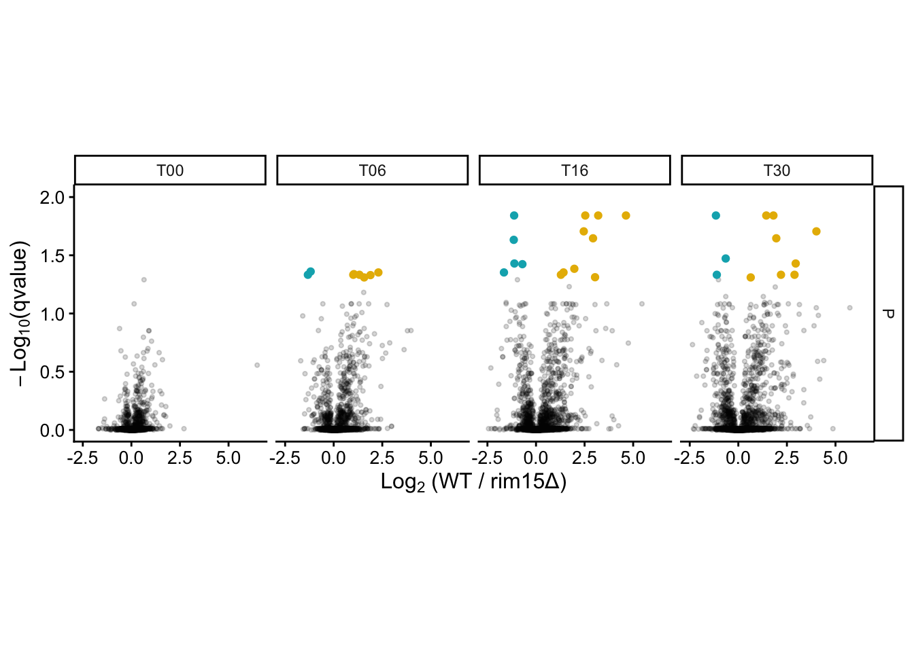

```
## Warning: Removed 16 rows containing missing values or values outside the scale range (`geom_point()`).
## Warning in grid.Call.graphics(C_text, as.graphicsAnnot(x$label), x$x, x$y, : conversion failure on ' (WT / rim15Δ)' in 'mbcsToSbcs':
## for Δ (U+0394)
```

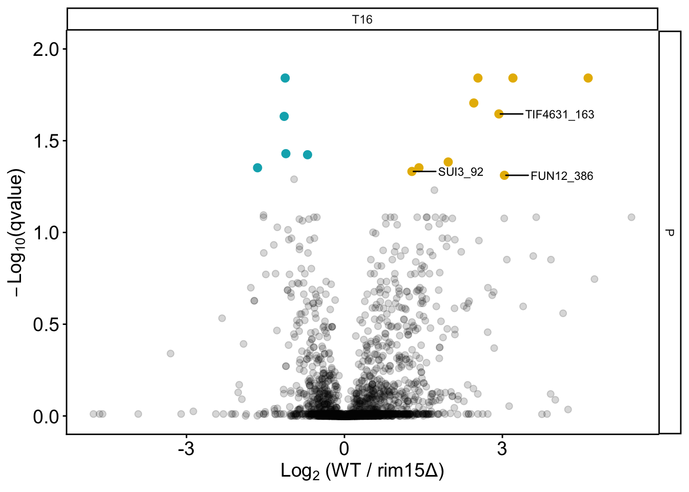

```
## Warning in grid.Call.graphics(C_text, as.graphicsAnnot(x$label), x$x, x$y, : conversion failure on ' (WT / rim15Δ)' in 'mbcsToSbcs':
## for Δ (U+0394)
## [1] 1
## [1] 5
## [1] 31
## `summarise()` has regrouped the output.
## ℹ Summaries were computed grouped by nutrient, time, and FC.
## ℹ Output is grouped by nutrient and time.
## ℹ Use `summarise(.groups = "drop_last")` to silence this message.
## ℹ Use `summarise(.by = c(nutrient, time, FC))` for per-operation grouping (`?dplyr::dplyr_by`) instead.
```

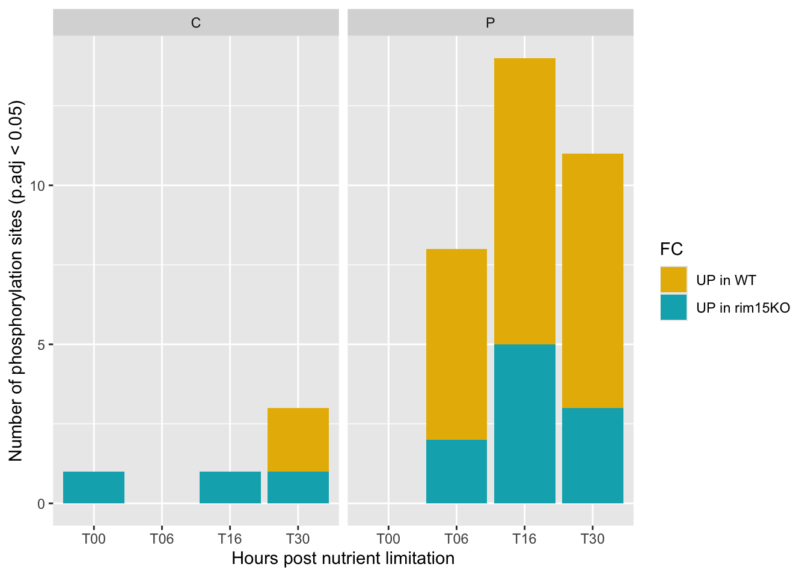

#collect sequence window for significantly changed pSites estimated by ttest


```
## NULL
## NULL
## NULL
```

#save sequence windows and make motifs using iceLogo


#summarize for the significantly differential expressed pSites

```
## `summarise()` has regrouped the output.
## ℹ Summaries were computed grouped by nutrient and time.
## ℹ Output is grouped by nutrient.
## ℹ Use `summarise(.groups = "drop_last")` to silence this message.
## ℹ Use `summarise(.by = c(nutrient, time))` for per-operation grouping (`?dplyr::dplyr_by`) instead.
## # A tibble: 6 × 3
## # Groups:   nutrient [2]
##   nutrient time  `n()`
##   <chr>    <fct> <int>
## 1 C        T00       1
## 2 C        T16       1
## 3 C        T30       3
## 4 P        T06       8
## 5 P        T16      14
## 6 P        T30      11
```

#look at the protein dynamics in who has a significant differential expression between rim15 and wt

```
## Rows: 3452 Columns: 76
## ── Column specification ─────────────────────────────────────────────────────────────────────────────────────────────────────────────
## Delimiter: ","
## chr  (4): Protein IDs, Protein names, Gene names, Fasta headers
## dbl (72): rim15KO_C_T00_R1, rim15KO_C_T00_R2, rim15KO_C_T00_R3, rim15KO_C_T06_R1, rim15KO_C_T06_R2, rim15KO_C_T06_R3, rim15KO_C_T...
## 
## ℹ Use `spec()` to retrieve the full column specification for this data.
## ℹ Specify the column types or set `show_col_types = FALSE` to quiet this message.
## Rows: 5056 Columns: 79
## ── Column specification ─────────────────────────────────────────────────────────────────────────────────────────────────────────────
## Delimiter: ","
## chr  (6): Proteins, pSite, Leading proteins, Protein names, Gene names, Fasta headers
## dbl (73): id, rim15KO_C_T00_R1, rim15KO_C_T00_R2, rim15KO_C_T00_R3, rim15KO_C_T06_R1, rim15KO_C_T06_R2, rim15KO_C_T06_R3, rim15KO...
## 
## ℹ Use `spec()` to retrieve the full column specification for this data.
## ℹ Specify the column types or set `show_col_types = FALSE` to quiet this message.
## Using Proteins, pSite, Leading proteins, Protein names, Gene names, Fasta headers as id variables
```

#GO term enrichment analysis
reference: https://learn.gencore.bio.nyu.edu/rna-seq-analysis/over-representation-analysis/

```
## Warning: package 'clusterProfiler' was built under R version 4.5.3
## clusterProfiler v4.18.4 Learn more at https://yulab-smu.top/contribution-knowledge-mining/
## 
## Please cite:
## 
## T Wu, E Hu, S Xu, M Chen, P Guo, Z Dai, T Feng, L Zhou, W Tang, L Zhan, X Fu, S Liu, X Bo, and G Yu. clusterProfiler
## 4.0: A universal enrichment tool for interpreting omics data. The Innovation. 2021, 2(3):100141
## 
## Attaching package: 'clusterProfiler'
## The following object is masked from 'package:purrr':
## 
##     simplify
## The following object is masked from 'package:stats':
## 
##     filter
## Loading required package: DOSE
## Warning: package 'DOSE' was built under R version 4.5.2
## DOSE v4.4.0 Learn more at https://yulab-smu.top/contribution-knowledge-mining/
## 
## Please cite:
## 
## Guangchuang Yu, Li-Gen Wang, Guang-Rong Yan, Qing-Yu He. DOSE: an R/Bioconductor package for Disease Ontology Semantic
## and Enrichment analysis. Bioinformatics. 2015, 31(4):608-609
## 
## using 'fgsea' for GSEA analysis, please cite Korotkevich et al (2019).
## preparing geneSet collections...
## GSEA analysis...
## Warning in .GSEA(geneList = geneList, exponent = exponent, minGSSize = minGSSize, : We do not recommend using nPerm parameter
## incurrent and future releases
## Warning in fgsea(pathways = geneSets, stats = geneList, nperm = nPerm, minSize = minGSSize, : You are trying to run fgseaSimple. It
## is recommended to use fgseaMultilevel. To run fgseaMultilevel, you need to remove the nperm argument in the fgsea function call.
## leading edge analysis...
## done...
```

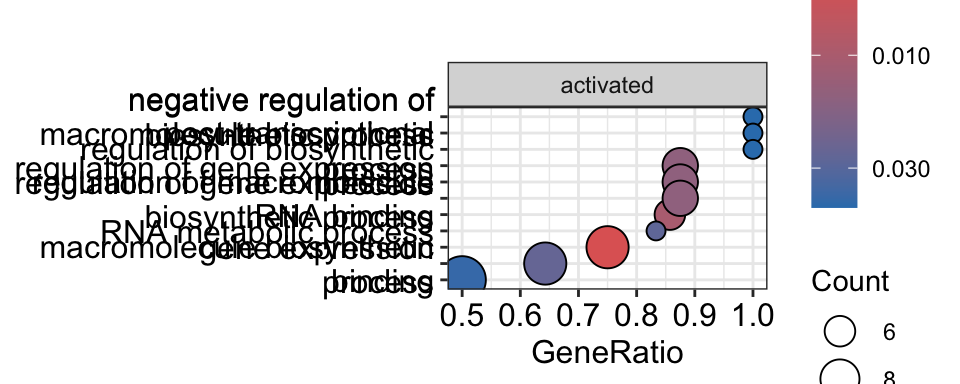


```
## Rows: 5056 Columns: 79
## ── Column specification ─────────────────────────────────────────────────────────────────────────────────────────────────────────────
## Delimiter: ","
## chr  (6): Proteins, pSite, Leading proteins, Protein names, Gene names, Fasta headers
## dbl (73): id, rim15KO_C_T00_R1, rim15KO_C_T00_R2, rim15KO_C_T00_R3, rim15KO_C_T06_R1, rim15KO_C_T06_R2, rim15KO_C_T06_R3, rim15KO...
## 
## ℹ Use `spec()` to retrieve the full column specification for this data.
## ℹ Specify the column types or set `show_col_types = FALSE` to quiet this message.
## Using Proteins, pSite, Leading proteins, Protein names, Gene names, Fasta headers as id variables
## 
## Using Proteins, pSite, Leading proteins, Protein names, Gene names, Fasta headers, genotype, time as id variables
## 
## `summarise()` has regrouped the output.
## Using Proteins, pSite, Leading proteins, Protein names, Gene names, Fasta headers, genotype, time as id variables
## 
## `summarise()` has regrouped the output.
## Warning: Removed 361 rows containing missing values or values outside the scale range (`geom_point()`).
## Warning: Removed 29 rows containing missing values or values outside the scale range (`geom_point()`).
```

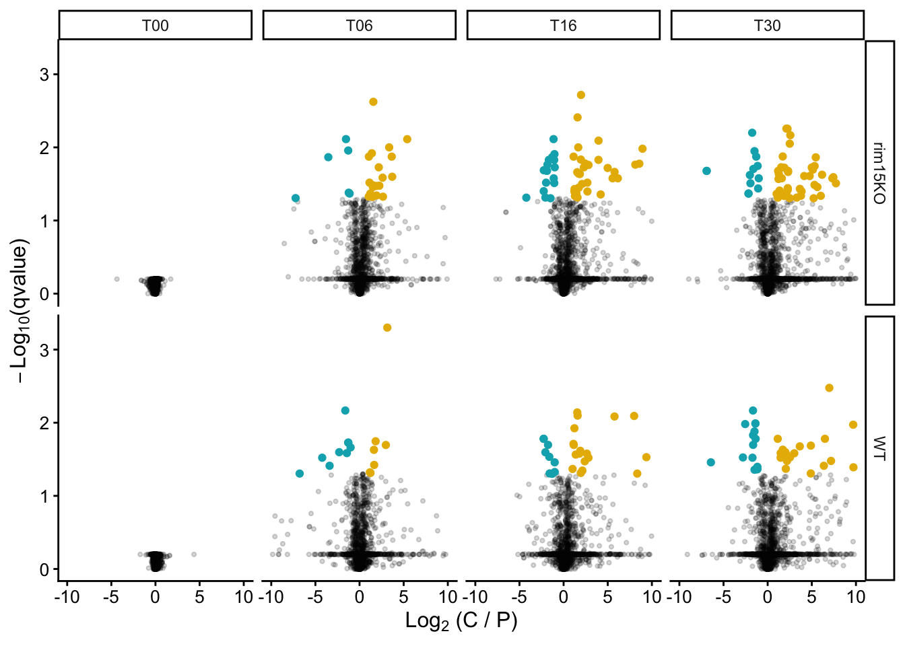

```
## Warning: Removed 361 rows containing missing values or values outside the scale range (`geom_point()`).
## Removed 29 rows containing missing values or values outside the scale range (`geom_point()`).
## `summarise()` has regrouped the output.
## ℹ Summaries were computed grouped by genotype, time, and FC.
## ℹ Output is grouped by genotype and time.
## ℹ Use `summarise(.groups = "drop_last")` to silence this message.
## ℹ Use `summarise(.by = c(genotype, time, FC))` for per-operation grouping (`?dplyr::dplyr_by`) instead.
```

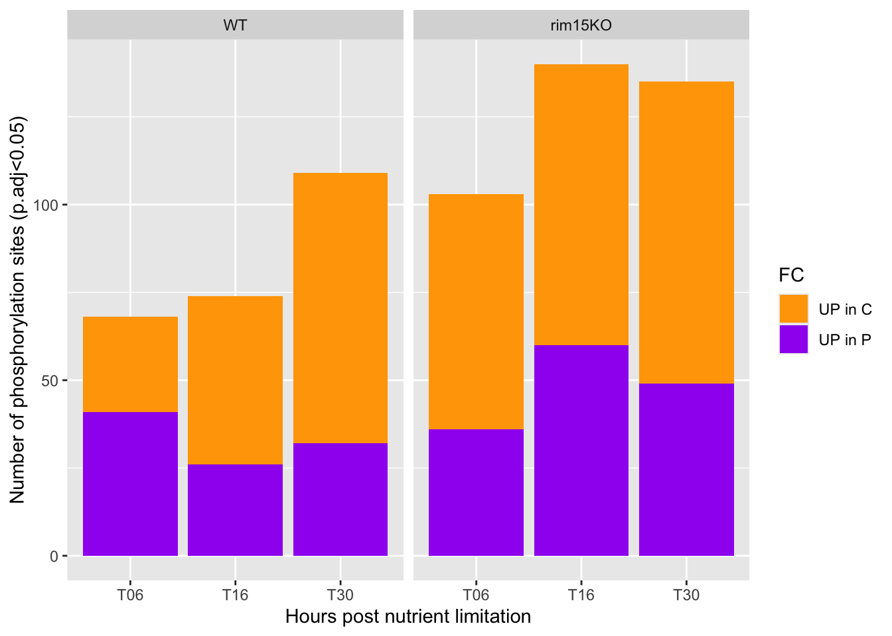
        
